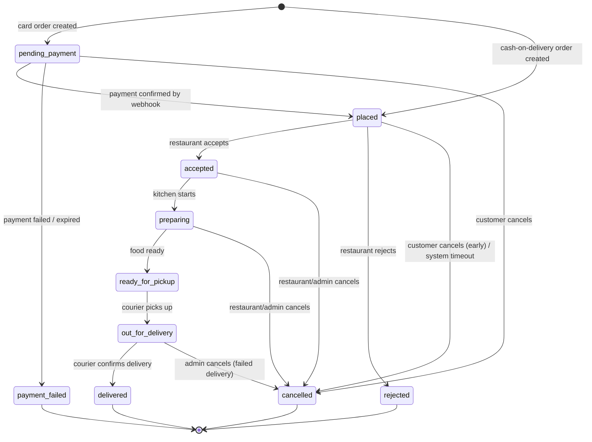

# Gochita Delivery — Architecture Document

**Status:** DRAFT v0.2 — for review (v0.2 adds 6 branches with own delivery zones). No code has been written. Do not start implementation until this document is approved.
**Date:** 2026-10-15
**Audience:** The product owner / beginner developer working with AI coding tools, and any future reviewer.

> **Important notes on honesty and scope**
> - Nothing in this document invents Gochita's menu, prices, branding, delivery fees, opening hours, or policies. Every such item is a **configurable data field** or listed in [Section 13: Open Business Decisions](#13-open-business-decisions).
> - Prices of third-party services and the exact capabilities of Georgian payment providers **change often**. Figures here are rough planning ranges and must be verified against current provider documentation before committing.
> - Legal/tax topics (personal data law, fiscal receipts, courier employment status) are flagged, not answered. Consult a Georgian lawyer/accountant.


> **Revision 0.2 (2026-10-15): 6 branches at launch, each with its own delivery zones**
> 1. `branches`: 6 rows from day one (names, addresses, phones are placeholders until the owner provides them).
> 2. `delivery_zones` belong to a branch (PostGIS polygon + fee, minimum order, free-delivery threshold, extra time). Zones of different branches may overlap (see D-OVERLAP).
> 3. Server function `resolve_branches(point)` returns every open branch whose active zone contains the address. The app never decides this itself.
> 4. One order = one branch. The branch and zone are stored on the order as a snapshot at creation time.
> 5. One shared catalogue (`products`) with per-branch `branch_products` (availability, optional price override, see D-BRANCHPRICE).
> 6. Staff accounts are scoped to a branch via RLS (`staff_branches`). Super admin sees all. pgTAP tests prove branch A staff cannot read or change branch B data.
> 7. Couriers have `home_branch_id` (see D-COURIERPOOL).
> 8. Promo codes and analytics can be global or per branch.
> 9. Order numbers are branch-prefixed so branches can tell them apart.
> 10. Realtime channel per branch: `branch:{id}:orders`. Customers subscribe only to their own order.
> 11. Extra tests: overlapping zones, address outside every zone, branch closed, zone disabled mid-checkout.

---

## Table of Contents

0. [Plain-language overview (read this first)](#0-plain-language-overview)
1. [System architecture](#1-system-architecture)
2. [Technology stack and reasons](#2-technology-stack-and-reasons)
3. [Database schema and relationships](#3-database-schema-and-relationships)
4. [Roles and permissions](#4-roles-and-permissions)
5. [Order lifecycle and state transitions](#5-order-lifecycle-and-state-transitions)
6. [Payment security and webhook architecture](#6-payment-security-and-webhook-architecture)
7. [Real-time tracking architecture](#7-real-time-tracking-architecture)
8. [Monorepo folder structure](#8-monorepo-folder-structure)
9. [MVP roadmap](#9-mvp-development-roadmap)
10. [Security risks and mitigations](#10-security-risks-and-mitigations)
11. [Testing and deployment strategy](#11-testing-and-deployment-strategy)
12. [Infrastructure costs and third-party dependencies](#12-estimated-infrastructure-costs-and-third-party-dependencies)
13. [Open business decisions](#13-open-business-decisions)
14. [MVP vs future features](#14-mvp-vs-future-features)
15. [Approval checklist](#15-approval-checklist)

---

## 0. Plain-language overview

Think of Gochita Delivery like a real restaurant with a few helpers:

| Real-world thing | In our system |
|---|---|
| The **menu board** and the **order notebook** | The **database** (Supabase PostgreSQL). It is the single source of truth. |
| The **front door security guard** | **Authentication + Row Level Security (RLS)**: decides who may see/do what. |
| The **cashier who calculates the bill** | **Server-side functions**. The phone app never decides the price; the server does. |
| The **bank terminal** | The **payment provider**. Card details never touch our system. |
| The **kitchen bell** | **Realtime** updates: the restaurant instantly sees new orders. |
| The **courier's walkie-talkie** | **GPS location updates** sent to the server and shown to the customer on a map. |
| The **text message to your phone** | **Push notifications**. |

Four "faces" use the same brain:

1. **Customer app** (phone): browse menu, order, pay, track.
2. **Courier app** (phone): receive deliveries, navigate, share GPS, mark delivered.
3. **Restaurant dashboard** (website): accept orders, manage menu, assign couriers.
4. **Super admin dashboard** (website): manage branches, staff, zones, promos, payments, analytics.

**The three golden rules of this design:**

1. **Never trust the phone.** The app can say "I want 2 khachapuri"; the *server* looks up the real price, applies the real discount, and calculates the real total.
2. **Only the server changes an order's status**, through strict rules. Nobody edits a status directly.
3. **Only the payment provider's signed message can mark an order as paid.** Not the app, not a return-page redirect.

If you remember only these three, you understand the security core of the whole system.

---

## 1. System architecture

### 1.1 High-level diagram

```
                              ┌────────────────────────────────────────┐
                              │              USERS / DEVICES            │
                              └────────────────────────────────────────┘
   ┌──────────────┐  ┌──────────────┐  ┌────────────────────┐  ┌─────────────────────┐
   │ Customer App │  │ Courier App  │  │ Restaurant Dashboard│  │ Super Admin Dashboard│
   │ Expo / RN    │  │ Expo / RN    │  │ Next.js (web)       │  │ Next.js (web)        │
   │ iOS+Android  │  │ iOS+Android  │  │ (staff, tablet/PC)  │  │ (owner)              │
   └──────┬───────┘  └──────┬───────┘  └─────────┬──────────┘  └──────────┬──────────┘
          │                 │                    │                        │
          └─────────────────┴──────────┬─────────┴────────────────────────┘
                                       │  HTTPS (TLS) + JWT (user login token)
                                       ▼
        ┌────────────────────────────────────────────────────────────────────┐
        │                         SUPABASE (EU region)                        │
        │                                                                     │
        │  ┌──────────────┐  ┌───────────────────┐  ┌──────────────────────┐ │
        │  │ Auth         │  │ PostgreSQL + PostGIS│  │ Realtime             │ │
        │  │ phone OTP /  │  │ tables, RLS policies│  │ (DB changes +        │ │
        │  │ email        │  │ RPC functions,      │  │  Broadcast channels) │ │
        │  └──────────────┘  │ triggers, pg_cron   │  └──────────────────────┘ │
        │                    └───────────────────┘                            │
        │  ┌──────────────────────────────┐  ┌───────────────────────────┐   │
        │  │ Edge Functions (TypeScript)   │  │ Storage (product images)  │   │
        │  │ - create-order                │  └───────────────────────────┘   │
        │  │ - create-payment-session      │                                  │
        │  │ - payment-webhook  ◄──────────┼──── Payment provider (server→server)
        │  │ - send-push                   │                                  │
        │  │ - reconcile-payments (cron)   │                                  │
        │  └───────────────┬───────────────┘                                  │
        └──────────────────┼──────────────────────────────────────────────────┘
                           │
        ┌──────────────────┼───────────────────────────────────────────────┐
        │  EXTERNAL SERVICES                                                │
        │  • Georgian payment provider (cards)   • Expo Push → FCM / APNs   │
        │  • Maps / geocoding / routing          • SMS provider (OTP)       │
        │  • Sentry (errors)                     • Vercel (hosts dashboards)│
        └───────────────────────────────────────────────────────────────────┘
```

### 1.2 Key architectural decisions

| # | Decision | Why |
|---|---|---|
| A1 | **Supabase is the backend.** No separate custom server in MVP. | One platform = Auth + DB + Realtime + Storage + Functions. Far fewer moving parts for a beginner. |
| A2 | **Business logic lives in Postgres functions (RPC) and Edge Functions**, not in the apps. | Apps are untrusted. Rules must run where users can't tamper with them. |
| A3 | **Row Level Security (RLS) is ON for every table**, deny-by-default. | Even if someone steals the public API key (it is public by design), they can only reach what their role allows. |
| A4 | **Orders change status only via a single function** `transition_order(order_id, new_status, ...)`. | One place to enforce the state machine, permissions, history, and notifications. |
| A5 | **Money is stored as integers in tetri** (1 GEL = 100 tetri). Currency GEL. | Avoids floating-point rounding bugs. |
| A6 | **Order items store snapshots** (name, price, options at time of purchase). | Later menu edits must never change historical orders or receipts. |
| A7 | **`branch_id` on every operational table from day one.** | "Multiple branches in the future" becomes configuration, not a rewrite. |
| A8 | **Cart lives on the device in MVP**; the server re-prices everything at checkout. | Simpler. Server-side carts are a future feature. |
| A9 | **Payments use a hosted/redirect payment page** (or provider SDK that tokenizes). | Our system never sees card numbers → minimal PCI burden. |
| A10 | **GPS is sent only through a restricted function, only while a courier has an active delivery.** | Privacy + abuse prevention + cost control. |
| A11 | **Shared TypeScript package** for types and validation (Zod) used by apps, dashboards, and Edge Functions. | One definition of "what is an order" everywhere; fewer bugs. |
| A12 | **Georgian (ka) is the default and required language**; English/Russian optional later. | Per requirements; texts are stored in translation-ready fields. |

### 1.3 Environments

| Environment | Purpose | Supabase project | Payments |
|---|---|---|---|
| `local` | Daily development on your computer | Supabase CLI (Docker) | Provider sandbox |
| `staging` | Testing with real-like setup, internal testers | Separate Supabase project | Provider sandbox/test mode |
| `production` | Real customers | Separate Supabase project | Live |

Never share databases or secrets between environments.

---

## 2. Technology stack and reasons

| Layer | Choice | Why (beginner-friendly reasoning) | Alternatives considered |
|---|---|---|---|
| Mobile apps | **React Native + Expo (TypeScript)** with **EAS Build** | One codebase for iOS + Android; huge community; AI tools know it well. | Flutter (good, but you asked for RN); native (too costly). |
| Navigation (mobile) | **Expo Router** | File-based routing, similar to Next.js → one mental model. | React Navigation directly. |
| Web dashboards | **Next.js (App Router) + TypeScript** | Same language/ideas as the mobile apps; easy hosting on Vercel. | Plain React SPA (weaker for auth/SSR). |
| UI (web) | **Tailwind CSS + shadcn/ui** | Fast, consistent dashboards, AI generates it well. | MUI, Mantine. |
| UI (mobile) | **NativeWind** (Tailwind for RN) or React Native StyleSheet + a small shared design-token file | Same design tokens as web. | Tamagui (more complex). |
| Backend platform | **Supabase** (Postgres, Auth, Realtime, Storage, Edge Functions) | Replaces a whole backend team. Postgres is rock-solid. | Firebase (NoSQL — poorer for orders/money/reporting); custom NestJS (more to maintain). |
| Database extras | **PostGIS** (geo), **pg_cron** (scheduled jobs), **pgcrypto** | Delivery-zone polygons; timeouts and reconciliation jobs. | — |
| Server logic | **Postgres functions (SQL/PLpgSQL)** for state machine & pricing; **Edge Functions (Deno/TypeScript)** for anything calling external APIs (payments, push) | Keeps critical rules next to the data; external calls in TS. | Separate Node server. |
| Data fetching | **TanStack Query** + generated Supabase types | Caching, retries, loading states handled for you. | Redux (heavier). |
| Forms/validation | **React Hook Form + Zod** (shared schemas) | One validation definition for client and server. | Formik/Yup. |
| State (local) | **Zustand** (cart, UI state) | Tiny and simple. | Redux Toolkit. |
| i18n | **i18next + expo-localization** (mobile), **next-intl** (web) | Georgian default; add languages later without refactoring. | — |
| Maps (mobile) | **react-native-maps** (Google/Apple map tiles) or **Mapbox** | See decision D-MAP in §13. Georgian address quality must be tested before deciding. | MapLibre + OSM (cheaper, weaker addresses). |
| Geocoding/routing | **Google Maps Platform** (default recommendation) or Mapbox | Best coverage of Tbilisi/Georgian towns is generally with Google; **verify with real addresses**. | Nominatim/OSM (free, coverage gaps). |
| Location tracking | **expo-location** + **expo-task-manager** (background) | Official, supported. Requires a **development build** (not Expo Go). | Third-party tracking SDKs (cost). |
| Push notifications | **Expo Notifications** (Expo Push Service → FCM/APNs) | Simplest path for beginners. | Direct FCM/APNs, OneSignal. |
| Auth | **Supabase Auth**: phone OTP for customers/couriers; email+password (+ optional MFA) for staff/admin | Phone number is the common identity for food delivery in Georgia. Needs an SMS provider (see §12). | Social login (adds Apple Sign-In obligation on iOS). |
| Payments | **Georgian provider** (e.g., Bank of Georgia iPay, TBC e-commerce, Flitt, Payze — **to be chosen**, see D-PAY) | Local cards, GEL settlement, local support. | Stripe (limited/unavailable for Georgian merchants — verify). |
| Monorepo tooling | **pnpm workspaces + Turborepo** | Shared code between 4 apps with fast builds. | Nx (more complex). |
| Error monitoring | **Sentry** (mobile + web + functions) | You find out about crashes before customers complain. | Bugsnag. |
| Analytics (product) | **PostHog** (optional, EU cloud) or only SQL-based analytics in MVP | Keep MVP simple; orders data is already in Postgres. | GA4/Firebase Analytics. |
| CI/CD | **GitHub Actions**, **EAS Build/Submit/Update**, **Vercel**, **Supabase CLI migrations** | Standard, well-documented, AI-friendly. | — |
| Testing | Vitest/Jest, **pgTAP** (DB/RLS tests), **Playwright** (web E2E), **Maestro** (mobile E2E) | Each tests a different risk. | Detox (heavier). |

### 2.1 Why not build a custom backend?

A custom Node/NestJS API is the "traditional" choice, but for a solo beginner it means: servers to patch, auth to build, realtime to build, scaling to handle. Supabase gives these as managed services. **Trade-off:** some logic lives in SQL, which has a learning curve. Mitigation: keep functions small, well-named, and covered by tests; AI tools write SQL well when given the schema.

**Exit strategy:** Supabase is open-source Postgres. If you ever outgrow it, the database can be moved; the business rules in SQL come with it.

### 2.2 Hosting region

Supabase has no Georgian region. Recommended: **EU (Frankfurt)** for the best latency to Georgia among available regions (verify at project creation). Note this for the privacy policy (data stored outside Georgia — see D-LEGAL).

### 2.3 Dashboards: one app or two?

**Recommendation for MVP:** a single Next.js app `apps/dashboard` with two protected route groups (`/restaurant/*` and `/admin/*`), enforced by middleware **and** database RLS. This halves deployment/maintenance work. If later you want separate domains/hardening for admin, split into two apps — shared packages make that cheap. (Listed as decision D-DASH.)

---

## 3. Database schema and relationships

> Conventions: `id uuid` primary keys (default `gen_random_uuid()`), `created_at/updated_at timestamptz`, soft-delete via `is_active`/`archived_at` where history matters, money in **integer tetri**, all timestamps in UTC (display in Asia/Tbilisi).
> Names below are *design-level*; exact SQL comes at implementation after approval.

### 3.1 Entity relationship overview

```
 auth.users ──1:1── profiles ──┬── addresses
                               ├── device_tokens
                               ├── staff_memberships ──► branches
                               ├── couriers (1:1)
                               └── orders (as customer)

 branches ──┬── branch_hours
            ├── delivery_zones (PostGIS polygon + fee rules)
            ├── branch_products (availability + optional price override)
            └── orders

 categories ──► products ──► product_option_groups ──► option_groups ──► options
 products ──► branch_products ◄── branches

 orders ──┬── order_items ──► order_item_options
          ├── order_status_history
          ├── payments ──► payment_events (raw webhooks)  ──► refunds
          ├── deliveries (courier assignments) ──► courier_locations
          └── promo_redemptions ◄── promo_codes

 audit_logs, notifications, app_settings, idempotency_keys (support tables)
```

### 3.2 Tables (columns that matter)

#### Identity & access

**`profiles`** — one row per user (extends `auth.users`)
- `id` (= auth user id), `full_name`, `phone` (E.164, unique), `email` (nullable), `preferred_language` (default `ka`), `marketing_opt_in`, `is_blocked`, `deleted_at`
- Notes: `role` is **not** stored here as a free-text field the user could influence; roles live in dedicated tables below.

**`staff_memberships`** — who works where, with which role
- `profile_id`, `branch_id` (nullable = all branches), `role` (`branch_manager` | `branch_operator`), `is_active`
- Super admins are stored in **`platform_admins`** (`profile_id`, `is_active`) — a separate table so it's hard to grant by accident.

**`couriers`**
- `profile_id` (PK/FK), `home_branch_id` (nullable), `vehicle_type` (`bike`|`scooter`|`car`|`foot`), `status` (`pending_approval`|`active`|`suspended`), `is_online`, `current_delivery_id` (nullable), `approved_by`, `approved_at`
- Courier documents/contract info are a **business decision** (D-COURIER) and kept out of MVP schema until decided.

#### Locations

**`branches`**
- `name_ka`, `name_en?`, `address_text`, `location` (geography point), `phone`, `is_active`, `is_accepting_orders` (manual pause switch), `accepts_cash_on_delivery` (bool, **restaurant-controlled**), `accepts_card_online` (bool), `prep_time_minutes_default` (configurable), `min_order_amount_tetri` (nullable)

**`branch_hours`** — `branch_id`, `weekday`, `open_time`, `close_time` (+ `branch_closures` for holidays)

**`delivery_zones`** — `branch_id`, `name`, `polygon` (geography), `delivery_fee_tetri`, `min_order_amount_tetri?`, `free_delivery_threshold_tetri?`, `estimated_minutes_extra?`, `is_active`, `priority`
- Fee logic: find the zone whose polygon contains the address point; pick highest `priority` if multiple. **Actual fee values are business-provided.**

**`addresses`** (customer saved addresses)
- `profile_id`, `label`, `street_text`, `building`, `entrance`, `floor`, `apartment`, `door_code` (sensitive), `note_for_courier`, `location` (geography point), `is_default`

#### Menu

**`categories`** — `name_ka`, `name_en?`, `sort_order`, `is_active`, `image_path?`
**`products`** — `category_id`, `name_ka`, `name_en?`, `description_ka?`, `base_price_tetri`, `image_path?`, `is_active`, `sort_order`, `allergen_info?` (business decision), `tax_category?` (business/accounting decision)
**`branch_products`** — `branch_id`, `product_id`, `is_available` (e.g., "sold out today"), `price_override_tetri?`
**`option_groups`** — `name_ka`, `selection_type` (`single`|`multiple`), `min_select`, `max_select`, `is_required`
**`options`** — `option_group_id`, `name_ka`, `price_delta_tetri` (can be 0), `is_active`, `sort_order`
**`product_option_groups`** — `product_id`, `option_group_id`, `sort_order`

> Customization examples (sizes, extras, removals) are handled by option groups. **No actual products/options are defined by this architecture.**

#### Orders

**`orders`**
- `id`, `order_number` (human-friendly, unique, non-guessable-enough; e.g., daily sequence + random suffix)
- `customer_id`, `branch_id`, `status` (see §5), `order_type` (`delivery` now; `pickup` future)
- Snapshot of address: `delivery_address_snapshot` (jsonb), `delivery_location` (geography)
- Money: `subtotal_tetri`, `discount_tetri`, `delivery_fee_tetri`, `service_fee_tetri` (default 0), `tip_tetri` (future), `total_tetri`
- `payment_method` (`card_online`|`cash_on_delivery`), `payment_status` (`unpaid`|`pending`|`paid`|`failed`|`refunded`|`partially_refunded`|`cod_pending`|`cod_collected`)
- `promo_code_id?`, `customer_note`, `estimated_ready_at`, `estimated_delivery_at`
- `cancelled_by` (`customer`|`restaurant`|`admin`|`system`), `cancel_reason_code`, `cancel_reason_text`
- `placed_at`, `accepted_at`, `ready_at`, `picked_up_at`, `delivered_at`, `cancelled_at`
- `idempotency_key` (unique per customer) — prevents double-submitted orders

**`order_items`** — `order_id`, `product_id` (reference only), `name_snapshot`, `unit_price_snapshot_tetri`, `quantity`, `line_total_tetri`, `note`
**`order_item_options`** — `order_item_id`, `option_id` (reference), `option_group_name_snapshot`, `option_name_snapshot`, `price_delta_snapshot_tetri`
**`order_status_history`** — `order_id`, `from_status`, `to_status`, `changed_by` (profile or `system`), `actor_role`, `reason?`, `created_at` (**append-only**)

#### Delivery

**`deliveries`** — one active row per order (history kept on reassignment)
- `order_id`, `courier_id?`, `status` (`unassigned`|`offered`|`assigned`|`arrived_at_branch`|`picked_up`|`arrived_at_customer`|`delivered`|`failed`|`cancelled`), `offered_at`, `assigned_at`, `picked_up_at`, `delivered_at`, `failure_reason?`, `cash_collected_tetri?` (COD), `pickup_code?`/`delivery_code?` (optional hand-over verification code, see §10)
**`courier_locations`** — `courier_id`, `delivery_id`, `location` (point), `heading?`, `speed?`, `accuracy_m`, `recorded_at`
- Retention: raw points kept short-term (e.g., 30–90 days — **business/legal decision**), then purged by cron. The *latest* position is also kept in `couriers_live` (one row per courier, upserted) for cheap reads.

#### Payments

**`payments`** — `order_id`, `provider` (`bog_ipay`|`tbc`|…), `provider_payment_id` (unique), `amount_tetri`, `currency` (`GEL`), `status` (`created`|`pending`|`succeeded`|`failed`|`cancelled`|`refunded`|`partially_refunded`), `checkout_url?`, `expires_at`, `failure_code?`, `created_at`, `confirmed_at`
**`payment_events`** — raw webhook log (append-only): `provider`, `event_id` (unique per provider), `payload` (jsonb), `signature_valid` (bool), `received_at`, `processed_at`, `processing_result`
**`refunds`** — `payment_id`, `amount_tetri`, `reason`, `requested_by`, `status`, `provider_refund_id`

#### Promotions

**`promo_codes`** — `code` (unique, case-insensitive), `discount_type` (`percent`|`fixed`|`free_delivery`), `value`, `max_discount_tetri?`, `min_order_tetri?`, `valid_from`, `valid_to`, `max_total_uses?`, `max_uses_per_customer?`, `applies_to_branch_id?`, `first_order_only?`, `is_active`
**`promo_redemptions`** — `promo_code_id`, `customer_id`, `order_id`, `discount_tetri` (unique `(promo_code_id, order_id)`)
> All specific promo rules are decided by Gochita; the system only enforces what is configured.

#### Support tables

**`device_tokens`** — `profile_id`, `expo_push_token`, `platform`, `app` (`customer`|`courier`), `last_seen_at`
**`notifications`** — `profile_id`, `type`, `title_ka`, `body_ka`, `data` (jsonb), `sent_at`, `read_at`
**`app_settings`** — key/value config (e.g., courier offer timeout seconds, order auto-cancel minutes) — **values are business decisions**
**`audit_logs`** — `actor_id`, `actor_role`, `action`, `entity`, `entity_id`, `before` (jsonb), `after` (jsonb), `ip?`, `created_at` — for admin actions (price change, refund, role grant, promo creation)
**`idempotency_keys`** — for retry-safe operations

### 3.3 Important database rules

1. **RLS enabled on all tables**; a table without a policy is inaccessible to clients.
2. **No direct INSERT/UPDATE on `orders.status`, `payments`, `order_status_history`, `courier_locations`** from clients. Only through `SECURITY DEFINER` functions or service-role Edge Functions.
3. **Constraints:** `CHECK (total_tetri = subtotal_tetri - discount_tetri + delivery_fee_tetri + service_fee_tetri)`; non-negative amounts; valid status enums; unique `provider_payment_id`; unique `(promo_code_id, order_id)`.
4. **Indexes:** `orders(branch_id, status, placed_at)`, `orders(customer_id, placed_at desc)`, GiST on zone polygons and location columns, `courier_locations(delivery_id, recorded_at desc)`.
5. **Migrations only** (SQL files in git). Never edit production tables by hand in the Supabase UI.
6. **Backups:** daily automatic; consider Point-in-Time Recovery for production (paid add-on).

### 3.4 Pricing calculation (server-side, authoritative)

When the customer taps "Place order", the server function `create_order` does, **in one database transaction**:

1. Verify user is signed in, not blocked, and phone-verified.
2. Verify branch is active and accepting orders, within opening hours.
3. Verify each product/option is active and available at that branch; verify option-group min/max rules.
4. Recompute prices from the database (ignore any prices sent by the app).
5. Determine delivery zone from the address point → delivery fee, minimum order.
6. Validate and apply promo code (dates, limits, per-user usage), calculate discount.
7. Verify chosen payment method is enabled for that branch.
8. Insert `orders`, `order_items`, `order_item_options`, `promo_redemptions`, history row.
9. Return the order (and, for card payments, trigger payment-session creation).

If anything fails, nothing is saved. The idempotency key makes retries safe.

---

## 4. Roles and permissions

### 4.1 Roles

| Role | Who | How they log in | Scope |
|---|---|---|---|
| **customer** | Anyone ordering | Phone OTP in customer app | Own profile, addresses, orders |
| **courier** | Delivery person (approved) | Phone OTP in courier app | Own profile; deliveries assigned/offered to them |
| **branch_operator** | Restaurant staff taking/preparing orders | Email+password (+MFA recommended) on dashboard | Orders of their branch(es); availability toggles |
| **branch_manager** | Restaurant manager | Email+password + **MFA** | Everything an operator can + menu availability/prices (as permitted), hours, couriers of branch, branch analytics |
| **super_admin** | Owner/admin | Email+password + **mandatory MFA** | All branches; users/roles; zones, fees, promos; payments/refunds; global analytics; settings |

A single person may hold multiple roles (e.g., a courier who is also a customer) — roles are **separate records**, and each app checks its own role.

### 4.2 Permission matrix (MVP)

| Action | Customer | Courier | Operator | Manager | Super admin |
|---|:--:|:--:|:--:|:--:|:--:|
| View menu & branch info | ✅ | ✅ | ✅ | ✅ | ✅ |
| Manage own addresses/profile | ✅ | ✅ | — | — | — |
| Place order | ✅ | — | — | — | — |
| View own orders | ✅ | — | — | — | — |
| Cancel own order (only early states) | ✅* | — | — | — | — |
| View branch orders | — | — | ✅ | ✅ | ✅ |
| Accept/reject/progress order | — | — | ✅ | ✅ | ✅ |
| Mark item/product unavailable | — | — | ✅ | ✅ | ✅ |
| Edit product prices/menu structure | — | — | ❌ | ✅† | ✅ |
| Assign/reassign courier | — | — | ✅ | ✅ | ✅ |
| See assigned delivery + customer address | — | ✅ (only assigned, only while active) | ✅ | ✅ | ✅ |
| Send GPS location | — | ✅ (only with active delivery) | — | — | — |
| Mark picked up / delivered | — | ✅ | — | ✅ (override, audited) | ✅ (audited) |
| Create promo codes | — | — | — | ❌/✅† | ✅ |
| Edit delivery zones/fees | — | — | — | ❌ | ✅ |
| Issue refunds | — | — | — | request only | ✅ |
| Manage staff & couriers | — | — | — | couriers of branch† | ✅ |
| View global analytics | — | — | — | — | ✅ |

\* Cancellation rules (until which status, refund behaviour) = business decision D-CANCEL.
† Whether managers may edit prices/promos = business decision D-PERMS. Default recommendation: **managers cannot change prices or create promos** (super admin only) until the owner decides otherwise.

### 4.3 How permissions are enforced (three layers)

1. **UI layer** — hides what you can't use (convenience only, NOT security).
2. **API layer** — Edge Functions/RPC check the caller's role before acting.
3. **Database layer (RLS)** — the real wall. Example policies (described in words):
   - *orders:* customer can `SELECT` rows where `customer_id = auth.uid()`; staff can `SELECT` rows where `branch_id` is in their active memberships; courier can `SELECT` only orders whose active delivery is assigned to them.
   - *courier_locations:* no direct writes; customer can read **only** the latest location of the courier assigned to **their** order and **only** while the delivery is active.
   - *customer phone/address visibility for couriers:* exposed through a restricted view that only returns the data needed for delivery, and only during an active delivery.

Helper SQL functions like `is_branch_staff(branch_id)`, `is_platform_admin()`, `is_courier()` keep policies readable and testable.

> **Rule:** Never put roles in a field the user can edit (e.g., user-editable metadata). Roles come from server-controlled tables.

---

## 5. Order lifecycle and state transitions

### 5.1 Order states

| State | Meaning |
|---|---|
| `pending_payment` | Order created, waiting for online card payment (card orders only) |
| `placed` | Confirmed (paid online, or COD chosen). Waiting for the restaurant. |
| `accepted` | Restaurant accepted and gave an estimate |
| `preparing` | Kitchen is preparing |
| `ready_for_pickup` | Food ready for courier |
| `out_for_delivery` | Courier picked up the order |
| `delivered` | Customer received it (**final**) |
| `cancelled` | Cancelled (by customer/restaurant/admin/system) (**final**) |
| `rejected` | Restaurant declined (**final**, triggers refund if paid) |
| `payment_failed` | Card payment failed/expired (**final**) |

> `preparing` could be merged into `accepted` for a leaner MVP. Decision D-STATES. The state machine is data-driven, so adding/removing a state is a controlled change in one function.

### 5.2 Diagram



### 5.3 Transition rules table (enforced in `transition_order`)

| From → To | Who may trigger | Conditions / side effects |
|---|---|---|
| `pending_payment` → `placed` | **System only** (payment webhook) | Payment verified `succeeded` and amount equals `orders.total_tetri`. Notify restaurant. |
| `pending_payment` → `payment_failed` | System (webhook / expiry job) | Release promo redemption. |
| `placed` → `accepted` | Operator/Manager/Admin | Set `estimated_ready_at`. Push to customer. |
| `placed` → `rejected` | Operator/Manager/Admin | Reason required. If paid: create refund task. Release promo. |
| `placed` → `cancelled` | Customer (early only) / System (unaccepted timeout) | Refund if paid. Timeout length = D-TIMEOUT. |
| `accepted` → `preparing` | Operator/Manager | — |
| `preparing` → `ready_for_pickup` | Operator/Manager | Triggers courier dispatch (offer or manual assignment). |
| `ready_for_pickup` → `out_for_delivery` | Courier (assigned) / Operator override | Requires assigned courier. Start GPS sharing to customer. Optional pickup code. |
| `out_for_delivery` → `delivered` | Courier (assigned) / Admin override | Optionally verify customer code and/or proximity. COD: record cash collected. Stop GPS sharing. |
| any active → `cancelled` | Operator/Manager/Admin | Reason required; refund path; audit log. |

**Hard guarantees:**
- Invalid transitions (e.g., `delivered` → `preparing`) are rejected by the database.
- Every transition writes `order_status_history` (append-only) and an `audit_logs` row when done by staff/admin.
- Each transition is **idempotent** (calling it twice with the same target doesn't break anything).
- Final states cannot be changed except by super-admin correction with audit log.

### 5.4 Delivery sub-lifecycle (`deliveries.status`)

`unassigned → offered → assigned → arrived_at_branch → picked_up → arrived_at_customer → delivered` (+ `failed`, `cancelled`).
The courier app drives this; progress events mirror into the order status (`picked_up` ⇒ order `out_for_delivery`; `delivered` ⇒ order `delivered`).

### 5.5 Courier assignment

- **MVP: manual assignment** by restaurant staff from a dashboard list of online couriers. Simple, predictable, easy to debug.
- **Phase 2: offer-based dispatch**: system offers the delivery to nearest eligible couriers one at a time (timeout, then next). Requires `courier_offers` table and a scheduled job — designed for but not built in MVP.
- **Future:** batching multiple orders, smart ETA, zone-based courier pools.
- If no courier accepts within X minutes → alert dashboard (threshold = business decision).

### 5.6 Timers and background jobs (pg_cron + Edge Functions)

| Job | Frequency | Purpose |
|---|---|---|
| Expire unpaid card orders | every minute | `pending_payment` older than N min → `payment_failed` |
| Auto-cancel unaccepted orders | every minute | `placed` older than N min → alert, then cancel (policy D-TIMEOUT) |
| Reconcile pending payments | every few minutes | Ask provider for status of payments stuck `pending` (guards against missed webhooks) |
| Courier stale-location sweep | every minute | Mark couriers offline if no GPS for N min |
| Purge old GPS points | daily | Enforce retention policy |
| Push receipt checks | every ~15 min | Remove dead push tokens |

---

## 6. Payment security and webhook architecture

### 6.1 Principles

1. **No card data ever touches our servers or apps** — hosted payment page / provider-tokenizing SDK (PCI scope: lowest category, but confirm with provider).
2. **The server decides the amount**, from the database, at payment-session creation.
3. **Payment success is established only by (a) a signature-verified webhook and/or (b) a server-to-server status query to the provider.** Never by the app saying "I paid" or by a redirect URL alone.
4. **Everything is idempotent**: duplicate webhooks are harmless.
5. **Everything is logged**: raw webhook payloads stored in `payment_events`.
6. **Secrets live only in Edge Function environment variables** (never in the apps, never in git).

### 6.2 Card payment flow

```
Customer App        Supabase (create-order)     Edge Fn: create-payment-session     Provider            Edge Fn: payment-webhook
     │  1. Place order  │                                │                               │                        │
     │ ───────────────► │ validate, price, insert order  │                               │                        │
     │                  │ status=pending_payment         │                               │                        │
     │                  │ ──────────────────────────────►│ 2. create payment (amount     │                        │
     │                  │                                │    from DB, order ref, return │                        │
     │                  │                                │    URLs, callback URL)        │                        │
     │                  │                                │ ─────────────────────────────►│                        │
     │                  │                                │ ◄───────── checkout URL ──────│                        │
     │ ◄──── checkout URL (via our API) ─────────────────│                               │                        │
     │ 3. Open provider's secure page (in-app browser)   │                               │                        │
     │ ────────────────────────────────────────────────────────────────────────────────►│ 4. customer pays       │
     │                                                                                   │ ──── signed webhook ──►│ 5. verify signature
     │                                                                                   │                        │    verify amount/currency/order
     │                                                                                   │                        │    idempotent update
     │                                                                                   │                        │    payments=succeeded
     │                                                                                   │                        │    order → placed
     │ ◄───────────────────── Realtime: order status changed ────────────────────────────────────────────────────│
     │ 6. App shows "Order placed"  (app also polls order status after returning from the payment page)           │
```

### 6.3 Webhook handler requirements (`payment-webhook` Edge Function)

1. **Publicly reachable**, but accepts only `POST` from the provider; **no user JWT** (provider can't send one) → so it must authenticate the message itself.
2. **Verify authenticity** using the provider's mechanism (HMAC signature, shared secret, signed JWT, or IP allow-list — *whichever the chosen provider supports; use the strongest available, preferably signature*). Compare with constant-time comparison. Reject otherwise (still log with `signature_valid=false`).
3. **Store the raw payload first** in `payment_events` (unique `(provider, event_id)`) — duplicates are detected here.
4. **Never trust amounts in the webhook alone**: load the payment/order from our DB and check `provider_payment_id`, `amount_tetri`, `currency`, and `order_id` match. Mismatch → flag for manual review, do **not** advance order.
5. **Optionally confirm by calling the provider's status API** (defense in depth against forged or replayed webhooks).
6. **Apply the update in a single DB transaction**: lock the payment row, ignore if already final, update `payments`, call `transition_order(pending_payment → placed)`.
7. **Respond quickly** with `200` once safely stored; do heavy work (push notifications) asynchronously.
8. **Return non-2xx on temporary failures** so the provider retries; design for out-of-order and duplicate delivery.
9. **Alert** (Sentry/email) on signature failures, amount mismatches, or processing errors.

### 6.4 Reconciliation (safety net)

If a webhook is lost, a cron job lists payments `pending` older than a few minutes and queries the provider's API for their real status, then applies the same idempotent update. A daily report compares provider settlements to our `payments` table and flags differences for the accountant.

### 6.5 Refunds

- Created by **super admin** (managers may *request*), via a function that calls the provider's refund API and records `refunds` + audit log.
- Automatic refund *tasks* are created on rejection/cancellation of paid orders; execution policy (auto vs. approval) is business decision D-REFUND.
- Partial refunds supported by schema (e.g., missing item).

### 6.6 Cash on delivery (COD)

- Enabled **per branch** by the restaurant (`accepts_cash_on_delivery`); can also be limited later (max amount, new customers, blocked users).
- Order goes straight to `placed` with `payment_status = cod_pending`.
- Courier records `cash_collected_tetri` at delivery; shows in end-of-shift reconciliation (who owes the restaurant what — accounting process is business decision D-COD).
- Abuse controls: block customers with repeated failed/fake COD orders; optional phone verification before COD.

### 6.7 Payment-related business/legal items to confirm

Provider fees & settlement time, chargeback handling, Apple/Google rules (physical food delivery payments are **not** subject to in-app purchase commission — standard for delivery apps), fiscal receipt obligations (Georgia Revenue Service rules — D-TAX), customer receipt format.

---

## 7. Real-time tracking architecture

### 7.1 Two kinds of real-time

| Need | Mechanism |
|---|---|
| **Order status** (placed → accepted → …) | **Supabase Realtime (Postgres Changes)** on `orders` filtered by RLS. Customer app subscribes to its own order; dashboard subscribes to its branch's orders. |
| **Courier GPS** (moving dot on map) | **Supabase Realtime Broadcast** channel per delivery (`delivery:{id}`), plus a persisted "latest location" row for late joiners. |

### 7.2 GPS data flow

```
Courier app (foreground service + background task)
   │  every N seconds (e.g., 5–10 s when moving; slower when idle — tunable)
   │  batches points if offline
   ▼
RPC  submit_courier_location(delivery_id, lat, lng, heading, speed, accuracy, recorded_at)
   │  checks: caller is the courier assigned to this delivery, delivery is active,
   │          rate limit, sane coordinates/speed, timestamp not in the future
   ├──► upsert couriers_live (latest position)
   ├──► insert courier_locations (history, optional / sampled)
   └──► broadcast to channel delivery:{id}
                  │
                  ▼
Customer app subscribed to delivery:{id}  → moves marker, updates ETA
Restaurant dashboard → map of active couriers
```

- **Access control for channels:** Realtime *authorization* (RLS on `realtime.messages` / private channels) ensures only the order's customer, the assigned courier, and staff of that branch can subscribe to `delivery:{id}`.
- **Privacy:** Tracking starts at `out_for_delivery` (or when courier is heading to the branch, if desired) and **ends at `delivered`**. The customer never sees a courier's location outside an active delivery of their order. Couriers see a visible "location is being shared" indicator.
- **Cost/battery control:** Adaptive update frequency, distance filter (e.g., only send when moved > X m), stop on delivery completion, 1 Hz is never needed.
- **ETA:** MVP — simple estimate from the map provider's routing API, called **rarely** (at pickup, and every few minutes), not on every GPS tick.

### 7.3 Mobile platform realities (important for a beginner)

- Background location requires a **development build / production build** via EAS (not Expo Go).
- **Android:** foreground service with a persistent notification; battery-optimization (Xiaomi/Huawei/Samsung) can kill tracking → courier onboarding must include "disable battery optimization" instructions.
- **iOS:** "Always" location permission + background mode; App Review requires a clear purpose string and privacy explanation.
- Permissions copy must be in Georgian and explain *why* location is needed.
- Plan for **offline/poor network**: queue points locally and send latest when back online.
- Must be tested on **real devices**, ideally 2–3 different Android brands.

### 7.4 Fallback

If real-time connection drops, apps fall back to polling the order/delivery every ~10–15 s, and refetch on app foreground. Push notifications carry the important state changes (accepted, picked up, arriving, delivered) regardless of live connection.

### 7.5 Push notifications

| Event | Recipient |
|---|---|
| New order placed | Restaurant (dashboard sound alert + optional push to staff device) |
| Order accepted / rejected / ready / out for delivery / delivered / cancelled | Customer |
| Courier assigned/offered | Courier |
| Courier arriving | Customer |
| Order not accepted in X min | Manager/Admin |

Sent by the `send-push` Edge Function (called by DB trigger/queue) via Expo Push; invalid tokens cleaned up. Texts are Georgian by default. Marketing push requires opt-in (`marketing_opt_in`).

---

## 8. Monorepo folder structure

```
gochita-delivery/
├── apps/
│   ├── customer-app/                 # Expo (React Native, TypeScript)
│   │   ├── app/                      # Expo Router screens
│   │   │   ├── (auth)/               # login, OTP
│   │   │   ├── (tabs)/               # home/menu, cart, orders, profile
│   │   │   ├── product/[id].tsx
│   │   │   ├── checkout.tsx
│   │   │   └── order/[id].tsx        # live status + map
│   │   ├── src/{components,features,hooks,lib,store,i18n}/
│   │   ├── app.config.ts
│   │   └── eas.json
│   ├── courier-app/                  # Expo (separate store listing)
│   │   ├── app/{(auth),(tabs),delivery/[id].tsx}
│   │   └── src/{features/location-tracking,...}
│   └── dashboard/                    # Next.js (App Router)
│       ├── app/
│       │   ├── (auth)/login/
│       │   ├── restaurant/           # operator/manager area
│       │   │   ├── orders/  menu/  couriers/  analytics/
│       │   └── admin/                # super-admin area
│       │       ├── branches/  zones/  promos/  users/  payments/  analytics/  settings/
│       ├── middleware.ts             # role-based route protection
│       └── src/{components,lib,i18n}/
│
├── packages/
│   ├── shared/                       # types, Zod schemas, constants, money helpers, status enums
│   ├── supabase-client/              # typed client factory, generated DB types
│   ├── i18n/                         # Georgian (ka) default + en strings, shared keys
│   ├── ui-tokens/                    # colors/spacing/typography tokens (Gochita branding added LATER by owner)
│   ├── eslint-config/
│   └── tsconfig/
│
├── supabase/
│   ├── migrations/                   # ALL schema changes as ordered SQL files
│   ├── functions/                    # Edge Functions
│   │   ├── create-payment-session/
│   │   ├── payment-webhook/
│   │   ├── send-push/
│   │   ├── reconcile-payments/
│   │   └── _shared/                  # helpers (auth, logging, provider adapters)
│   │       └── payments/             # provider adapter interface + implementations
│   ├── tests/                        # pgTAP tests (RLS, state machine, pricing)
│   ├── seed.sql                      # FAKE test data only — clearly marked, never real menu
│   └── config.toml
│
├── e2e/
│   ├── web/                          # Playwright
│   └── mobile/                       # Maestro flows
│
├── docs/
│   ├── ARCHITECTURE.md               # this file
│   ├── DECISIONS.md                  # log of business decisions & answers
│   ├── RUNBOOK.md                    # what to do when things break
│   ├── SECURITY.md
│   └── API.md                        # RPC / function contracts
│
├── .github/workflows/                # CI: lint, typecheck, test, db-test, build, deploy
├── turbo.json
├── pnpm-workspace.yaml
├── package.json
├── .env.example                      # names only, never values
└── README.md
```

**Rules for the repo:**
- Provider integration uses an **adapter interface** (`PaymentProvider`) so switching Georgian providers touches one folder.
- Secrets never in git (`.gitignore` + secret scanning on GitHub).
- The Supabase **service-role key** is never in any app or dashboard client code — only in Edge Function secrets.
- Two Expo apps share code through `packages/`, not by copying.

---

## 9. MVP development roadmap

> Time estimates are for **one beginner developer working part/full-time with AI coding tools**, assuming decisions are answered promptly. Treat as ranges, not promises. Total realistic MVP: **roughly 5–8 months** (not counting app-store review and pilot).

### Phase 0 — Decisions & setup (2–3 weeks, can overlap with Phase 1)
- Answer critical business decisions (§13: payment provider, COD, zones, cancellation, tax, languages).
- Open merchant account with payment provider (this can take **weeks** — start immediately).
- Create accounts: GitHub, Supabase, Vercel, Expo, Apple Developer ($99/yr), Google Play ($25 one-time), Sentry, maps provider.
- Verify SMS OTP delivery to Georgian numbers.
- Test map/geocoding quality on real Georgian addresses.
- Repo + CI skeleton, environments (local/staging/prod).

### Phase 1 — Foundation (3–4 weeks)
- Monorepo, shared packages, lint/typecheck/CI.
- Database schema v1 + RLS + helper functions + pgTAP tests.
- Auth (phone OTP, staff email login), profiles, roles.
- Dashboard shell with role-based access.
- ✅ *Exit criteria:* a test user of each role can log in and sees only what they should (proved by automated tests).

### Phase 2 — Menu & ordering core (4–6 weeks)
- Dashboard: branch, hours, categories, products, option groups, availability toggles, image upload.
- Customer app: Georgian UI, browse menu, product customization, cart (local), addresses (map pin + text), delivery zone/fee preview.
- `create_order` server function with full server-side pricing.
- COD ordering path end-to-end (simplest first).
- Restaurant dashboard: live incoming orders with sound, accept/reject/progress.
- Customer: order status screen (realtime), order history.
- ✅ *Exit:* complete COD order from phone → kitchen → delivered (manually progressed), on staging.

### Phase 3 — Payments (3–4 weeks)
- Provider adapter, `create-payment-session`, `payment-webhook`, reconciliation job, refunds (admin).
- Payment UX in app (open checkout, return handling, failure/retry).
- Payment security tests (forged webhook, duplicate, amount mismatch, lost webhook).
- ✅ *Exit:* sandbox payments work including all failure cases; real small-amount live test completed.

### Phase 4 — Couriers & tracking (4–6 weeks)
- Courier onboarding/approval (admin), courier app: online/offline, delivery list, status steps, navigation deep-link to maps app.
- Manual assignment from dashboard.
- Background GPS, `submit_courier_location`, realtime broadcast, customer live map.
- Push notifications for all key events.
- ✅ *Exit:* real-device test delivery in the field with live map and push.

### Phase 5 — Promos, admin & analytics basics (2–3 weeks)
- Promo codes (create/validate/redeem), admin: zones/fees, users, couriers, refunds.
- Basic analytics (orders/day, revenue, avg. value, top products, cancellations, courier delivery times) via SQL views.
- Audit logs viewer.

### Phase 6 — Hardening & launch prep (3–4 weeks)
- Security review (§10 checklist), load/soak test with simulated orders & couriers, backup/restore drill.
- Privacy policy, terms, account deletion flow (required by Apple/Google), store listings in Georgian.
- Monitoring, alerts, runbook, staff training material.
- TestFlight / internal testing → store submission (allow review time).
- **Pilot:** limited area/hours, real orders, daily review, then expand.

### Phase 7+ — Post-MVP (see §14)

**Scope-control rule:** a feature not in §14 "MVP" column is *not built* until the MVP pilot is stable.

---

## 10. Security risks and mitigations

| # | Risk | Impact | Mitigation |
|---|---|---|---|
| S1 | **Client-side price tampering** | Customer pays less | Server recomputes all prices; apps' prices are display-only; DB `CHECK` constraints. |
| S2 | **Broken access control / missing RLS** (most common Supabase vulnerability) | Data leak of customers/orders | RLS on every table, deny-by-default; pgTAP tests for each role; CI fails if a table lacks RLS; periodic Supabase security advisor check. |
| S3 | **Service-role key leaked** | Full DB takeover | Key only in Edge Function secrets; never in apps/dashboard client bundle; secret scanning; rotation procedure in runbook. |
| S4 | **Forged/replayed payment webhook** | Free orders | Signature verification, amount/order match, idempotency, optional provider status re-check, alerts. |
| S5 | **Marking order "paid" from the app** | Free orders | No client path exists; only webhook/reconcile functions with service role. |
| S6 | **Double-submit / retry creating duplicate orders or charges** | Duplicate cost, angry customers | Idempotency keys; unique constraints; disable-button UX; server dedupe. |
| S7 | **Promo code abuse** (brute force, sharing, stacking) | Revenue loss | Server-side validation, per-user and global limits, rate limiting on validate endpoint, non-guessable codes, no stacking unless defined. |
| S8 | **OTP/SMS abuse (SMS pumping)** | SMS bill explosion | Rate limits per phone/IP/device, CAPTCHA/attestation where possible, daily SMS budget alert, block premium/unexpected country prefixes. |
| S9 | **Account takeover (staff/admin)** | Fraud, data theft | Strong passwords + **mandatory MFA** for admin/manager, session timeouts, login alerts, least privilege, audit logs. |
| S10 | **Courier location misuse / stalking** | Privacy harm, legal exposure | Location only visible during active delivery; short retention; RLS on channels; visible tracking indicator; access to history only for admin with audit. |
| S11 | **Customer PII exposure** (phones, addresses, door codes) | Legal/reputation | Minimal data to courier; mask phone via in-app call/relay (future) ; encrypt sensitive fields where feasible; no PII in logs/Sentry; retention policy. |
| S12 | **Fake GPS (courier spoofing)** | Fake deliveries | Plausibility checks (speed/jumps), proximity check at delivery, hand-over code, mock-location detection on Android, admin review of anomalies. |
| S13 | **Fraudulent delivery confirmation / theft of cash** | Revenue loss | Delivery code/proximity, photo proof (future), COD cash reconciliation per courier/shift, deposit rules (business). |
| S14 | **COD abuse (prank/fake orders)** | Wasted food & courier time | Verified phone, COD limits for new customers, block list, repeat-offender flags. |
| S15 | **DDoS / API abuse / scraping** | Downtime, cost | Supabase rate limiting, Edge Function throttling, CDN/WAF for dashboard (Vercel), pagination limits, no unbounded queries. |
| S16 | **SQL injection / XSS** | Data breach | Parameterized queries only (Supabase client/RPC), no string-built SQL, React escaping, strict CSP on dashboard, sanitize user text (notes). |
| S17 | **Insecure dependencies / supply chain** | Malware, backdoors | Lockfile, Dependabot, `pnpm audit` in CI, review AI-suggested packages before adding. |
| S18 | **AI-generated insecure code** (relevant for you) | Any of the above | Every PR/phase reviewed against this document; security tests are mandatory; never accept code that disables RLS "to make it work". |
| S19 | **Insider mistakes** (staff deletes menu/changes prices) | Business disruption | Roles, audit logs, soft-delete, backups, price-change confirmations. |
| S20 | **Data loss** | Business-ending | Daily backups + PITR for prod, tested restore, migrations in git. |
| S21 | **Single points of failure** (Supabase/Vercel/payment provider outage) | Can't take orders | Status monitoring, graceful error UX, "pause ordering" switch, COD fallback, runbook, incident contact list. |
| S22 | **Push token / notification spoofing** | Phishing-style fake alerts | Push sent only server-side; tokens bound to authenticated user; deep links validated. |
| S23 | **Over-permissive storage buckets** | Image abuse / data leak | Public bucket for menu images only (admin-write); private bucket for anything sensitive; size/type limits. |
| S24 | **Compliance gaps** (personal data law, app-store rules, consumer rights) | Fines, delisting | Legal review (D-LEGAL); privacy policy; consent records; account deletion; data export/erasure process. |
| S25 | **Timing/race conditions** (two staff accept same order; courier double-accept) | Inconsistent state | DB row locks / `SELECT … FOR UPDATE`, state-machine validation, unique active delivery per order. |

**Security process (lightweight but real):**
1. Threat model checklist at the end of every phase.
2. Automated tests for access control and payments (cannot be skipped).
3. Before launch: independent review of RLS + payment code (a paid freelance review is worth it).
4. Incident plan: who to contact, how to disable ordering, how to rotate keys, how to notify customers if required by law.

---

## 11. Testing and deployment strategy

### 11.1 Test pyramid for this project

| Level | Tool | What it proves | Examples |
|---|---|---|---|
| Unit | Vitest/Jest | Pure logic works | Money math, formatters, status helpers, Zod schemas |
| **Database/RLS** | **pgTAP** via `supabase test db` | **Security rules & state machine** (most important tests) | "Customer A can't read customer B's order"; "operator of branch 1 can't touch branch 2"; invalid transitions rejected; pricing function correct; promo limits |
| Function/integration | Deno tests + provider sandbox | Edge Functions & payments | Webhook: valid, forged, duplicate, wrong amount, out-of-order, lost→reconciled |
| Component | React Testing Library / RN Testing Library | UI renders states correctly | Cart totals display, Georgian text present |
| Web E2E | Playwright | Dashboard flows | Operator logs in → sees new order → accepts |
| Mobile E2E | Maestro | App flows on emulator/real device | Sign up → add to cart → COD checkout → see status |
| Manual field tests | Real phones | GPS, push, payment UX | Courier tracking across Android brands & iOS |
| Load/soak | k6 (or similar) | System holds under peak | Simulated peak dinner hour: orders + 50 couriers pinging GPS |
| Security | Supabase advisors, dependency audit, optional pen-test | Known weaknesses | Pre-launch review |

**Minimum rule:** every table has at least one RLS test; every state transition has a positive and a negative test; every payment failure mode has a test.

### 11.2 Quality gates (CI on every pull request — GitHub Actions)

1. Install, lint, typecheck (all packages)
2. Unit tests
3. Start local Supabase → apply migrations → run pgTAP tests
4. Build dashboard and both Expo apps (typecheck/export)
5. Secret scanning + dependency audit
6. Merge to `main` only if green

### 11.3 Deployment

| Component | How | Notes |
|---|---|---|
| Database | `supabase db push` / CI applies migrations to **staging**, then **production** after approval | Backward-compatible migrations; never destructive without backup; test on staging first. |
| Edge Functions | `supabase functions deploy` via CI | Secrets set per environment. |
| Dashboard | Vercel (preview deploys per PR; production from `main`) | Env vars per environment. |
| Mobile apps | **EAS Build** → TestFlight / Play internal testing → store release | Staging builds point to staging backend. |
| Mobile hotfixes | **EAS Update** (OTA) for JS-only fixes | Native changes still need a store release; keep **minimum supported app version** check so you can force-update broken/insecure versions. |

**Release process:** feature branch → PR → CI → merge → staging deploy → smoke test checklist → production deploy (dashboards/functions) / store release (apps) → monitor Sentry for an hour.
**Rollback plan:** Vercel instant rollback; previous Edge Function version redeploy; migrations are forward-fixes (write a corrective migration), with PITR as last resort; EAS Update rollback for OTA.

### 11.4 Monitoring & operations

- **Sentry** for crashes/errors (mobile, web, functions) — with PII scrubbing.
- **Uptime monitor** on dashboard and a health Edge Function.
- **Alerts:** webhook failures, payments stuck pending, orders not accepted, SMS spend spike, error-rate jump, DB CPU/connection limits.
- **Logs:** Supabase logs retained per plan; structured logging in functions (no secrets/PII).
- **Business dashboard (admin):** live open orders, avg. accept time, avg. delivery time, failed payments.
- **Runbook** (`docs/RUNBOOK.md`): "payments failing", "Supabase down", "courier GPS not updating", "restaurant can't see orders", "pause ordering".

### 11.5 Pilot / rollout

1. Internal testing (team + friends) on staging.
2. Closed beta: small group of real customers, limited zone/hours, staff close at hand.
3. Soft launch → watch metrics and fix.
4. Expand zones/hours/branches.
Keep a **manual fallback** (phone orders) during pilot.

---

## 12. Estimated infrastructure costs and third-party dependencies

> ⚠️ **These are rough planning figures** based on typical public pricing models and may be outdated. Verify current pricing on each vendor's site before budgeting. Georgian payment provider fees and SMS prices are **not** estimated here because they depend on negotiated contracts.

### 12.1 Monthly running costs (MVP / small-scale, approximate)

| Item | Approx. cost | Notes |
|---|---|---|
| Supabase Pro (production) | ~US$25/mo + usage/compute add-ons | Free tier is fine for development only; production should be Pro for backups and no pausing. PITR is an extra. |
| Supabase staging | Free tier or second small project | Free projects can pause when inactive. |
| Vercel (dashboard) | Free (hobby, non-commercial) or ~US$20/user/mo (Pro) | **Commercial use requires a paid plan** under Vercel's terms — verify. |
| Expo EAS | Free tier (limited builds) or paid plan (~tens of USD/mo) | Paid plan useful for faster/more builds. |
| Sentry | Free tier → ~US$26+/mo | Free is OK for MVP start. |
| Maps (geocoding, routing, map tiles) | Usage-based; often within free monthly credit at small volume | Set **budget caps and alerts**; avoid calling routing on every GPS tick. |
| SMS OTP | Per-message; depends on provider & Georgian carrier rates | Biggest *surprise* cost risk if abused → rate-limit. |
| Push notifications | Free (Expo Push / FCM / APNs) | |
| Domain + DNS + email | ~US$1–5/mo equivalent | |
| Uptime monitoring | Free–~US$10/mo | |
| **Typical MVP infrastructure total** | **≈ US$60–200 / month** excluding SMS, maps overage, and payment fees | Grows with order volume, GPS frequency, realtime connections. |

### 12.2 One-time / annual

| Item | Cost |
|---|---|
| Apple Developer Program | US$99 / year |
| Google Play Console | US$25 one-time |
| Legal review (privacy policy, terms, data law) | Variable — recommended |
| Optional pre-launch security review | Variable — recommended |
| Branding/design assets | Owner-provided (not covered here) |

### 12.3 Variable costs to model with Gochita's real numbers
- Payment provider percentage/fixed fee per transaction (+ refund/chargeback fees).
- SMS per login (reduce with long-lived sessions).
- Realtime message volume ∝ (active couriers × update frequency × viewers).
- Database size growth (GPS history is the biggest — hence retention).
- Map API calls per order.

### 12.4 Third-party dependency register

| Dependency | Critical? | Risk if it fails | Mitigation |
|---|---|---|---|
| Supabase | **Yes** | Whole system down | Status monitoring, backups, pause switch; exportable Postgres |
| Payment provider | **Yes** for card | Can't take cards | COD fallback (if enabled), clear UX, alerting |
| SMS provider | **Yes** (login) | Users can't sign in | Existing sessions persist; secondary provider (future); email fallback for staff |
| Maps/geocoding | High | Address entry/ETAs degrade | Allow manual address + pin; cache; budget caps |
| Expo/EAS & Apple/Google stores | High | Can't ship updates | Keep release cadence modest; OTA for small fixes |
| Expo Push/FCM/APNs | Medium | No push (still have realtime/polling) | Fallback to in-app polling |
| Vercel | Medium | Dashboard down | Rollback; could self-host Next.js |
| Sentry | Low | Less visibility | — |

**Vendor lock-in notes:** Postgres/SQL portable; Next.js portable; Expo portable; payment adapter isolates provider; the most Supabase-specific parts are Auth and Realtime.

---

## 13. Open business decisions

> The architecture supports each of these as **configuration**, but the *answers* must come from Gochita. Priority: 🔴 blocks design/development soon, 🟡 needed before launch, 🟢 can wait.

### Payments & finance
| ID | Question | Priority |
|---|---|---|
| **D-PAY** | Which Georgian payment provider (and does it support: hosted checkout, webhooks with signatures, refunds API, saved cards/tokenization, sandbox)? Has Gochita already got a merchant account/bank relationship? | 🔴 |
| D-COD | Is cash on delivery offered at launch? Per branch? Max order amount? How is courier cash handed over/reconciled? | 🔴 |
| D-TAX | VAT/fiscal receipt obligations for online orders and delivery fees? Which accounting/cash-register (RS.ge) integration is needed? Receipt format? | 🟡 |
| D-REFUND | Refund policy: automatic vs. approval; refund destination; time limits; partial refunds? | 🟡 |
| D-FEES | Delivery fee structure, minimum orders, free-delivery thresholds, service fee, tips? (Provided by business — **not invented here**.) | 🔴 |
| D-PROMO | What promotion types and rules are wanted at launch? Who may create them? Can they stack? | 🟡 |

### Operations
| ID | Question | Priority |
|---|---|---|
| D-ZONES | Delivery area(s) and zone boundaries; max delivery distance; different zones/fees/times? | 🔴 |
| D-HOURS | Opening hours, pre-orders/scheduled orders allowed? Kitchen capacity limits? | 🟡 |
| D-BRANCH | ✅ ANSWERED: 6 branches at launch, each with own delivery zones. Still needed: names, addresses, phones, hours of each | ✅ |
| D-OVERLAP | If an address is inside zones of several branches: nearest branch, customer chooses, or fixed priority? (Design shows customer choice with a "nearest" badge) | 🔴 |
| D-BRANCHPRICE | Same menu and prices in all 6 branches, or per-branch prices/availability? | 🟡 |
| D-COURIERPOOL | Couriers tied to one branch or shared between branches? | 🟡 |
| D-ZONEDATA | Who draws the zone boundaries and what are the fees/minimums/times per zone? | 🔴 |
| D-STATES | Is the `preparing` status wanted? Any extra states (e.g., "arriving")? | 🟢 |
| D-TIMEOUT | How long may an order wait for acceptance? What happens then (alert vs. auto-cancel)? | 🟡 |
| D-CANCEL | When can a customer cancel (until which state)? Cancellation fees? Who bears cost of food already prepared? | 🔴 |
| D-ASSIGN | Manual assignment only at launch, or automatic dispatch? | 🟡 |
| D-ETA | How are prep time and delivery time estimates set (fixed, manual, dynamic)? | 🟢 |
| D-OUTOFSTOCK | What should happen when an ordered item becomes unavailable after payment (substitute, partial refund, cancel)? | 🟡 |

### Couriers
| ID | Question | Priority |
|---|---|---|
| D-COURIER | Employees or independent contractors? Own vehicles? Documents/verification needed? Pay model (per delivery/hourly)? Shift scheduling? Courier pay tracking in-app? | 🔴 |
| D-HANDOVER | Required hand-over proof: PIN code, photo, signature, none? | 🟡 |

### Product & brand
| ID | Question | Priority |
|---|---|---|
| D-LANG | Georgian only at launch, or also English/Russian? | 🟡 |
| D-BRAND | Logo, colors, fonts, tone of voice, app names/store listing texts (**to be supplied by Gochita**). | 🟡 |
| D-MENU | Menu structure, products, options, allergen/nutrition info, photos (**to be supplied by Gochita**). | 🔴 (content, not architecture) |
| D-AUTH | Phone OTP only for customers, or also email/social login? Guest checkout allowed? | 🟡 |
| D-MAP | Preferred map provider; budget for map usage; test results with real Georgian addresses. | 🔴 |
| D-DASH | One dashboard app with two areas (recommended) or two separate apps? | 🟢 |
| D-PERMS | Can managers edit prices/promos, or super admin only? Exact operator/manager powers? | 🟡 |
| D-SUPPORT | Customer support channel (phone, in-app chat, WhatsApp)? Who handles complaints/refund requests? | 🟡 |
| D-REVIEWS | Ratings/reviews wanted? (future by default) | 🟢 |

### Legal & compliance
| ID | Question | Priority |
|---|---|---|
| D-LEGAL | Personal data protection compliance in Georgia (consent, data controller registration if applicable, cross-border storage in EU region), terms of service, privacy policy, consumer-protection rules, data retention periods (orders, GPS, logs). **Needs a Georgian lawyer.** | 🔴 |
| D-AGE | Age restrictions (e.g., alcohol/tobacco sold?) — if yes, extra verification and legal rules. | 🟡 |
| D-ANALYTICS | Which analytics/tracking is acceptable and what consent is needed? | 🟢 |

---

## 14. MVP vs future features

| Area | **MVP (build first)** | **Later (design supports, don't build yet)** |
|---|---|---|
| Customer app | Georgian UI; phone OTP login; browse menu; product options; local cart; saved addresses with map pin; checkout (card + COD if enabled); promo code entry; live order status; push; order history; profile; account deletion | Reorder shortcut, favorites, scheduled orders, pickup mode, ratings/reviews, loyalty points, referral codes, in-app chat/support, English/Russian UI, tipping, saved cards (provider tokens), Apple/Google sign-in |
| Courier app | Login; online/offline; see/accept (or be assigned) deliveries; status steps; navigation deep link; GPS sharing; COD amount entry | Auto-offer dispatch with timer, batching, earnings screen, shifts, photo proof, in-app call masking, heat maps, incentives |
| Restaurant dashboard | Live orders with sound; accept/reject/progress; menu & availability management; manual courier assignment; hours/pause switch; daily summary | Multi-screen kitchen display, printer integration, inventory, staff scheduling, advanced reports, POS integration |
| Super admin | Branches, staff & couriers, zones/fees, promo codes, payments view & refunds, basic analytics, audit log, settings | Multi-brand support, advanced BI/exports, fraud scoring, automated payouts/settlement reports, A/B tests, campaign tools |
| Payments | One Georgian provider (card), webhooks, reconciliation, refunds, COD | Multiple providers, wallets, gift cards, split payments |
| Delivery | Zones (polygon) + fixed fees; manual assignment | Dynamic pricing/surge, distance-based fees, smart ETA, route optimization |
| Platform | Supabase, single region, daily backups, Sentry | Read replicas, queue system, dedicated services, data warehouse |
| Multi-branch | **6 branches at launch**: branch-scoped zones, staff, orders, availability, Realtime | Cross-branch order transfer, automatic load balancing between branches |

---

## 15. Approval checklist

Before any code is written, the product owner should confirm:

- [ ] Overall architecture (Supabase + Expo + Next.js + Edge Functions) is accepted
- [ ] One dashboard app with two role areas (or request split)
- [ ] Order states and transitions (§5) match how the restaurant really works
- [ ] Manual courier assignment for MVP is acceptable
- [ ] Card + (optional) COD scope for MVP
- [ ] 🔴 business decisions in §13 have answers or an agreed deadline
- [ ] Payment provider chosen (or shortlisted and sandbox access requested)
- [ ] Map/geocoding quality tested with real addresses
- [ ] Budget in §12 is acceptable
- [ ] Legal review scheduled (D-LEGAL)
- [ ] Roadmap phases and the "no scope creep" rule are accepted

**Next step after approval:** Phase 0/1 only — repo skeleton, environments, schema v1 with RLS, and automated access-control tests. No feature code before those pass.

---
*End of document — v0.2 DRAFT*
